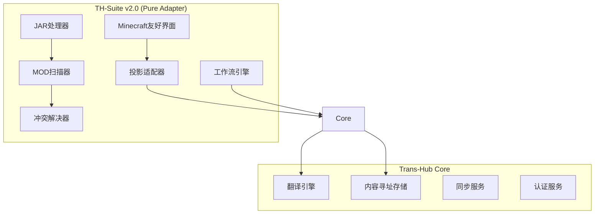

# TH-Suite v2.0 开发者指南

> 📚 **Core-First专业适配器开发指南** - 架构设计、开发规范和最佳实践

## 📋 目录

- [架构概览](#架构概览)
- [开发环境配置](#开发环境配置)
- [核心组件详解](#核心组件详解)
- [开发工作流](#开发工作流)
- [测试策略](#测试策略)
- [部署指南](#部署指南)
- [贡献指南](#贡献指南)

## 🏗️ 架构概览

### Core-First架构原则

TH-Suite v2.0采用Core-First架构，专注于作为Trans-Hub生态系统的专业适配器：



### 目录结构

```
apps/mc_l10n/
├── src/
│   ├── adapters/              # 适配器层
│   │   ├── core_client.py     # Trans-Hub Core客户端
│   │   ├── projection.py      # 投影适配器 (Minecraft ↔ UIDA)
│   │   └── minecraft_core_adapter.py  # 核心适配器
│   ├── domain/                # 领域层
│   │   ├── mod_loaders.py     # MOD加载器注册表
│   │   ├── mod_scanner.py     # MOD扫描器
│   │   └── jar_processor.py   # JAR处理器
│   ├── services/              # 服务层
│   │   ├── minecraft_workflow.py     # 工作流引擎
│   │   ├── pack_builder.py          # 包构建器
│   │   └── conflict_resolver.py     # 冲突解决器
│   └── configs/               # 配置
│       └── mc-projection.yaml  # 投影规范配置
├── frontend/
│   └── src/
│       ├── components/ModLoader/    # MOD加载器UI组件
│       ├── services/              # API服务
│       └── theme/                 # Minecraft主题系统
└── tests/                     # 测试套件
    ├── test_projection_adapter.py
    ├── test_minecraft_workflow.py
    ├── test_jar_processor.py
    ├── test_mod_loaders.py
    └── test_conflict_resolver.py
```

## 🛠️ 开发环境配置

### 系统要求

- **Python**: 3.12+ (推荐3.12.7)
- **Node.js**: 18+ (推荐18.19.0)
- **Rust**: 1.70+ (Tauri构建需要)
- **操作系统**: Windows 10+, macOS 12+, Linux (Ubuntu 20.04+)

### 快速启动

```bash
# 1. 安装依赖
task install                    # 或 npm run install:all

# 2. 启动开发服务器
task dev:mc                     # 启动完整开发环境 (前端+后端)

# 3. 分别启动服务 (可选)
task dev:mc:backend             # 仅后端 (端口18000)
task dev:mc:frontend            # 仅前端 (端口18001)
```

### 开发工具配置

#### VS Code扩展推荐

```json
{
  "recommendations": [
    "ms-python.python",
    "ms-python.black-formatter",
    "ms-python.mypy",
    "bradlc.vscode-tailwindcss",
    "esbenp.prettier-vscode",
    "rust-lang.rust-analyzer",
    "tauri-apps.tauri-vscode"
  ]
}
```

#### 代码质量工具

```bash
# Python代码检查
ruff check apps/                # 代码风格检查
mypy apps/ packages/            # 类型检查
pytest tests/ -v                # 运行测试

# 前端代码检查  
npm run type-check              # TypeScript检查
npm run lint                    # ESLint检查
npm run format:check            # Prettier格式检查
```

## 🧩 核心组件详解

### 1. 投影适配器 (Projection Adapter)

**职责**: Minecraft语言文件 ↔ UIDA双向转换，确保数据一致性

```python
# apps/mc_l10n/src/adapters/projection.py
class MinecraftProjectionAdapter:
    async def project_to_uida(self, lang_files: List[MinecraftLanguageFile]) -> List[UIDAFile]:
        """Minecraft → UIDA投影"""
        
    async def project_from_uida(self, uida_files: List[UIDAFile]) -> List[MinecraftLanguageFile]:
        """UIDA → Minecraft反向投影"""
```

**配置文件** (`configs/mc-projection.yaml`):

```yaml
name: "minecraft_projection"
version: "1.0.0"
source_format: "minecraft_lang"
target_format: "trans_hub_uida"

key_expressions:
  namespace: "^([a-z_]+)\\."           # 提取命名空间
  category: "\\.(gui|item|block)\\."   # 提取类别
  identifier: "\\.([^.]+)$"           # 提取标识符

context_mapping:
  gui: "界面"
  item: "物品"  
  block: "方块"
```

### 2. MOD加载器系统

**职责**: 智能识别和处理多种MOD加载器类型

```python
# apps/mc_l10n/src/domain/mod_loaders.py
class ModLoaderRegistry:
    def __init__(self):
        self.detectors = {
            ModLoaderType.FORGE: ForgeModLoader(),
            ModLoaderType.FABRIC: FabricModLoader(),
            ModLoaderType.QUILT: QuiltModLoader(), 
            ModLoaderType.NEOFORGE: NeoForgeModLoader()
        }
    
    async def detect_loader(self, jar_path: Path) -> Optional[ModLoaderInfo]:
        """自动检测MOD加载器类型"""
        
    async def extract_metadata(self, jar_path: Path) -> Optional[ModMetadata]:
        """提取完整的MOD元数据"""
```

**支持的加载器**:
- **Forge**: `META-INF/mods.toml`, `mcmod.info`
- **NeoForge**: `META-INF/neoforge.mods.toml`  
- **Fabric**: `fabric.mod.json`
- **Quilt**: `quilt.mod.json` (向下兼容Fabric)

### 3. 工作流引擎

**职责**: 管理完整的本地化工作流程

```python
# apps/mc_l10n/src/services/minecraft_workflow.py
class MinecraftWorkflowEngine:
    async def create_workflow(self, name: str, pack_id: str, target_path: str) -> LocalizationWorkflow:
        """创建本地化工作流"""
        
    async def run_workflow(self, workflow_id: str) -> WorkflowResult:
        """执行工作流"""
```

**标准工作流步骤**:
1. **扫描** (SCAN) - 识别MOD文件和结构
2. **提取** (EXTRACT) - 提取语言文件
3. **摄入** (INGEST) - 上传到Trans-Hub Core
4. **翻译** (TRANSLATE) - 触发自动翻译
5. **同步** (SYNC) - 同步翻译结果  
6. **验证** (VALIDATE) - 验证翻译质量
7. **构建** (BUILD) - 构建本地化产物

### 4. JAR处理器

**职责**: 安全的JAR文件修改，支持备份和回滚

```python
# apps/mc_l10n/src/domain/jar_processor.py
class AdvancedJarProcessor:
    def __init__(self, backup_dir: Path):
        self.backup_manager = JarBackupManager(backup_dir)
        self.signature_verifier = JarSignatureVerifier()
        self.integrity_checker = JarIntegrityChecker()
    
    def process_jar(self, jar_path: Path, modifications: Dict[str, str]) -> JarProcessingResult:
        """安全处理JAR文件"""
        
    def rollback_changes(self, jar_path: Path, backup_path: Path) -> bool:
        """回滚到备份版本"""
```

### 5. 冲突解决器

**职责**: 检测和解决翻译冲突

```python  
# apps/mc_l10n/src/services/conflict_resolver.py
class MinecraftConflictResolver:
    async def detect_local_conflicts(self, pack_id: str, new_files: List[MinecraftLanguageFile]) -> List[FileConflict]:
        """检测本地冲突"""
        
    async def resolve_conflicts(self, new_files: List[MinecraftLanguageFile], conflicts: List[FileConflict]) -> List[MinecraftLanguageFile]:
        """解决冲突"""
```

**冲突类型**:
- `CONTENT_MISMATCH` - 翻译内容不同
- `PLACEHOLDER_MISMATCH` - 占位符不匹配
- `MISSING_KEYS` - 缺失翻译键
- `EXTRA_KEYS` - 多余翻译键

## 🔄 开发工作流

### 1. 功能开发流程


### 2. Git工作流

采用Git Flow模型：

```bash
# 1. 功能开发
git checkout -b feature/mod-loader-support
git commit -m "feat: 添加Quilt MOD加载器支持"

# 2. 测试和集成
git checkout develop
git merge feature/mod-loader-support

# 3. 发布准备
git checkout -b release/v2.1.0
git commit -m "chore: 准备v2.1.0发布"

# 4. 主干合并
git checkout main
git merge release/v2.1.0
git tag v2.1.0
```

### 3. API设计原则

遵循RESTful API设计：

```python
# 好的API设计
POST /api/v1/mod-loader/scan
GET /api/v1/mod-loader/scan/{scan_id}/progress
GET /api/v1/mod-loader/scan/{scan_id}/result

# 避免的设计
POST /api/scanMods
GET /api/getProgress?id=123
```

## 🧪 测试策略

### 测试金字塔

```
    ┌─────────────────┐
    │   E2E Tests     │  10%
    ├─────────────────┤
    │ Integration     │  20%
    │     Tests       │
    ├─────────────────┤
    │   Unit Tests    │  70%
    └─────────────────┘
```

### 1. 单元测试

**覆盖率要求**: 核心业务逻辑 ≥ 90%，整体覆盖率 ≥ 70%

```python
# tests/test_projection_adapter.py
class TestMinecraftProjectionAdapter:
    @pytest.mark.asyncio
    async def test_minecraft_key_to_uida(self, adapter):
        """测试Minecraft键转换为UIDA"""
        key = "minecraft.gui.done"
        text = "完成"
        
        uida = await adapter._minecraft_key_to_uida(key, text)
        
        assert uida.namespace == "minecraft"
        assert uida.category == "gui"
        assert uida.identifier == "done"
```

### 2. 集成测试

```python
# tests/test_minecraft_workflow.py
@pytest.mark.asyncio
async def test_complete_localization_workflow(self, workflow_engine):
    """测试完整本地化工作流"""
    workflow = await workflow_engine.create_workflow(
        name="集成测试工作流",
        pack_id="test_pack",
        target_path="/test/path"
    )
    
    result = await workflow_engine.run_workflow(workflow.workflow_id)
    assert result.success is True
```

### 3. 前端组件测试

```typescript
// frontend/src/components/ModLoader/ModInfoCard.test.tsx
describe('ModInfoCard', () => {
  test('renders mod information correctly', () => {
    const mockMod: ModInfo = {
      mod_id: 'test_mod',
      name: 'Test Mod',
      version: '1.0.0',
      loader_type: 'forge'
    }
    
    render(<ModInfoCard mod={mockMod} />)
    
    expect(screen.getByText('Test Mod')).toBeInTheDocument()
    expect(screen.getByText('v1.0.0')).toBeInTheDocument()
  })
})
```

### 运行测试

```bash
# Python测试
pytest tests/ -v --cov=src --cov-report=html

# 前端测试
npm run test

# 端到端测试
npm run test:e2e
```

## 🚀 部署指南

### 1. 构建应用

```bash
# 构建桌面应用
task build:mc                  # 构建MC L10n应用

# 手动构建步骤
cd apps/mc_l10n/frontend
npm run tauri:build            # 构建Tauri应用
```

### 2. Docker部署 (可选)

```dockerfile
# Dockerfile
FROM python:3.12-slim

WORKDIR /app
COPY . .

RUN pip install -r requirements.txt
CMD ["python", "main.py"]
```

### 3. 配置管理

环境配置使用`.env`文件：

```bash
# .env.production
TRANS_HUB_API_URL=https://api.trans-hub.net
TRANS_HUB_API_KEY=your_api_key
LOG_LEVEL=INFO
BACKUP_RETENTION_DAYS=30
```

## 🤝 贡献指南

### 代码规范

#### Python代码风格

```python
# 使用ruff进行代码格式化
# 遵循PEP 8标准，最大行长度88字符

class MinecraftProjectionAdapter:
    """
    Minecraft投影适配器
    
    Args:
        spec: 投影规范配置
        
    Returns:
        适配器实例
    """
    
    def __init__(self, spec: ProjectionSpec) -> None:
        self.spec = spec
        self.text_stabilizer = TextStabilizer()
```

#### TypeScript代码风格

```typescript
// 使用Prettier格式化，ESLint检查
// 函数式编程优先，避免class

interface ModInfo {
  mod_id: string
  name: string
  version: string
  loader_type: 'forge' | 'fabric' | 'quilt' | 'neoforge'
}

export const ModInfoCard: React.FC<{ mod: ModInfo }> = ({ mod }) => {
  // 组件实现
}
```

### 提交信息格式

采用[Conventional Commits](https://www.conventionalcommits.org/zh-hans/)规范：

```bash
feat: 添加Quilt MOD加载器支持
fix: 修复投影适配器空键值处理
docs: 更新API文档
test: 添加冲突解决器测试用例
refactor: 重构JAR处理器备份逻辑
```

### Pull Request流程

1. **Fork仓库**并创建功能分支
2. **编写代码**，确保通过所有检查
3. **添加测试**，维护覆盖率要求
4. **更新文档**，包括API文档和用户文档
5. **提交PR**，详细描述变更内容
6. **代码审查**，至少需要一名维护者审批
7. **合并代码**，删除功能分支

### 问题报告

使用Issue模板报告问题：

```markdown
## 问题描述
简要描述遇到的问题

## 复现步骤
1. 打开应用
2. 选择MOD目录
3. 点击扫描
4. 出现错误

## 期望行为
描述期望的正确行为

## 环境信息
- OS: Windows 11
- Python: 3.12.7
- TH-Suite: v2.0.1
```

## 📚 参考资料

### 技术文档

- **Trans-Hub Core API**: [API文档](https://docs.trans-hub.net/api)
- **UIDA规范**: [统一标识符和寻址规范](https://docs.trans-hub.net/uida)
- **Minecraft模组开发**: [Forge文档](https://docs.minecraftforge.net/), [Fabric文档](https://fabricmc.net/wiki/)

### 代码示例

- **投影适配器示例**: `apps/mc_l10n/src/adapters/projection.py`
- **工作流引擎示例**: `apps/mc_l10n/src/services/minecraft_workflow.py`  
- **UI组件示例**: `apps/mc_l10n/frontend/src/components/ModLoader/`

### 设计模式

- **适配器模式**: 投影适配器，MOD加载器检测器
- **策略模式**: 冲突解决策略，包构建策略
- **观察者模式**: 工作流进度通知
- **工厂模式**: MOD加载器注册表
- **命令模式**: 工作流步骤执行

---

## 📞 联系方式

- **项目维护者**: TH-Suite开发团队
- **问题反馈**: [GitHub Issues](https://github.com/your-org/th-suite/issues)
- **开发讨论**: [GitHub Discussions](https://github.com/your-org/th-suite/discussions)

---

*最后更新: 2024-09-12*