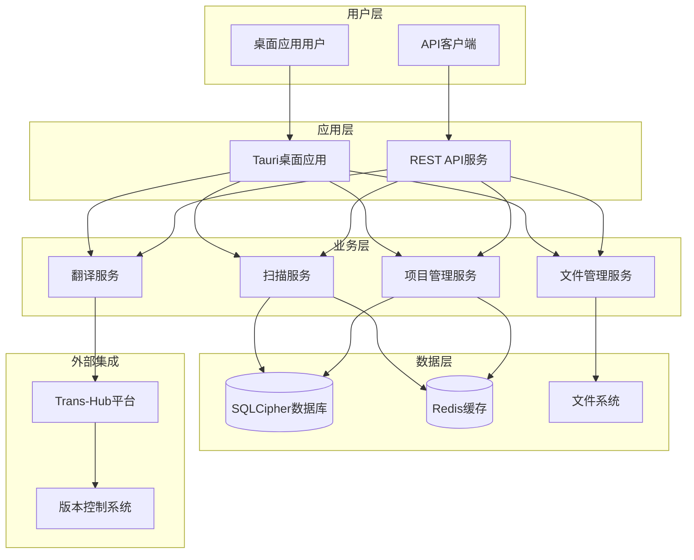
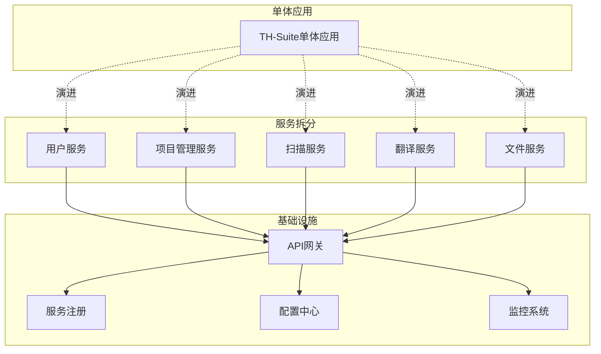

# TH-Suite 架构设计文档 v3.0

## 📋 目录

- [概述](#概述)
- [架构原则](#架构原则)
- [技术栈](#技术栈)
- [系统架构](#系统架构)
- [前端架构](#前端架构)
- [后端架构](#后端架构)
- [数据架构](#数据架构)
- [项目结构](#项目结构)
- [核心功能模块](#核心功能模块)
- [部署架构](#部署架构)
- [性能优化](#性能优化)
- [安全性设计](#安全性设计)
- [扩展性设计](#扩展性设计)
- [开发规范](#开发规范)

---

## 概述

TH-Suite (TransHub Suite) 是一个现代化的游戏本地化工具套件，专为游戏开发者和玩家提供专业的本地化解决方案。本架构设计文档基于前期的架构经验和重构成果，采用现代化、简洁、高效的设计理念。

### 🎯 设计目标

- **简洁高效**: 避免过度工程化，保持架构的简洁性
- **类型安全**: 前后端统一类型定义，确保类型安全
- **模块化**: 清晰的模块边界，支持独立开发和测试
- **可扩展**: 支持功能扩展和技术演进
- **开发者友好**: 提供优秀的开发体验和工具链

### 🔄 演进历史

- **v1.x**: 初始架构，存在代码冗余和架构复杂问题
- **v2.x**: 引入DDD和CQRS，但实现过于复杂
- **v3.x**: 现代化简洁架构，平衡功能性和简洁性

---

## 架构原则

### 1. 简洁性原则 (Simplicity)


- 优先选择简单的解决方案
- 避免不必要的抽象层
- 只在确实需要时引入复杂性

### 2. 一致性原则 (Consistency)

- 前后端使用相同的设计模式
- 统一的数据模型和接口定义
- 一致的代码风格和命名规范

### 3. 可测试性原则 (Testability)

- 依赖注入支持单元测试
- 清晰的接口定义便于mock
- 独立的功能模块支持隔离测试

### 4. 渐进式演进原则 (Evolutionary)

- 支持增量式功能开发
- 向后兼容的API设计
- 渐进式的架构升级路径

---

## 技术栈

### 前端技术栈

| 类别 | 技术 | 版本 | 用途 |
|------|------|------|------|
| **框架** | React | 18.3+ | 用户界面框架 |
| **语言** | TypeScript | 5.2+ | 类型安全的JavaScript |
| **桌面应用** | Tauri | 2.8+ | 跨平台桌面应用框架 |
| **构建工具** | Vite | 5.0+ | 快速构建工具 |
| **UI框架** | Material-UI | 5.14+ | React UI组件库 |
| **样式** | TailwindCSS | 4.1+ | 实用优先的CSS框架 |
| **状态管理** | Zustand | 4.4+ | 轻量级状态管理 |
| **HTTP客户端** | Axios | 1.6+ | HTTP请求库 |
| **表单处理** | React Hook Form | 7.48+ | 高性能表单处理 |

### 后端技术栈

| 类别 | 技术 | 版本 | 用途 |
|------|------|------|------|
| **框架** | FastAPI | 0.115+ | 现代化异步Web框架 |
| **语言** | Python | 3.12+ | 高级编程语言 |
| **数据库** | SQLCipher | 4.5+ | 加密SQLite数据库 |
| **ORM** | SQLAlchemy | 2.0+ | Python SQL工具包 |
| **验证** | Pydantic | 2.5+ | 数据验证和序列化 |
| **异步** | asyncio | 内置 | 异步编程支持 |
| **缓存** | Redis | 7.0+ | 内存数据结构存储 |
| **日志** | structlog | 23.2+ | 结构化日志库 |

### 开发工具链

| 类别 | 工具 | 用途 |
|------|------|------|
| **包管理** | Poetry (Python) / pnpm (Node.js) | 依赖管理 |
| **任务运行** | Task | 任务自动化 |
| **代码检查** | Ruff (Python) / ESLint (JS) | 代码质量检查 |
| **格式化** | Black (Python) / Prettier (JS) | 代码格式化 |
| **类型检查** | MyPy (Python) / TypeScript (JS) | 静态类型检查 |
| **测试** | pytest (Python) / Vitest (JS) | 单元测试框架 |

---

## 系统架构

### 整体架构图



### 核心组件

#### 1. 扫描引擎 (Scan Engine)

```typescript
interface ScanEngine {
  scanDirectory(path: string): Promise<ScanResult>;
  parseFiles(files: File[]): Promise<TranslationUnit[]>;
  validateResults(results: ScanResult): ValidationResult;
}

interface ScanResult {
  projectId: string;
  mods: Mod[];
  languageFiles: LanguageFile[];
  statistics: ScanStatistics;
}
```

#### 2. 翻译管理 (Translation Manager)

```typescript
interface TranslationManager {
  syncWithTransHub(): Promise<SyncResult>;
  updateTranslation(key: string, value: string): Promise<void>;
  exportTranslations(format: ExportFormat): Promise<Blob>;
}

interface SyncResult {
  success: boolean;
  updatedCount: number;
  errors: SyncError[];
}
```

#### 3. 项目管理 (Project Manager)

```typescript
interface ProjectManager {
  createProject(config: ProjectConfig): Promise<Project>;
  updateProject(id: string, config: ProjectConfig): Promise<void>;
  deleteProject(id: string): Promise<void>;
  listProjects(): Promise<Project[]>;
}
```

---

## 前端架构

### 组件层次结构

```
src/
├── components/           # 可复用组件
│   ├── common/          # 通用组件
│   │   ├── Button/
│   │   ├── Modal/
│   │   ├── Loading/
│   │   └── Toast/
│   ├── business/        # 业务组件
│   │   ├── ProjectCard/
│   │   ├── ScanProgress/
│   │   ├── TranslationEditor/
│   │   └── FileTree/
│   └── layout/          # 布局组件
│       ├── Header/
│       ├── Sidebar/
│       ├── MainContent/
│       └── Footer/
├── pages/               # 页面组件
│   ├── Dashboard/
│   ├── ProjectList/
│   ├── ProjectDetail/
│   ├── ScanPage/
│   ├── TranslationPage/
│   └── Settings/
├── hooks/               # 自定义Hooks
│   ├── useApi.ts
│   ├── useProject.ts
│   ├── useScan.ts
│   └──.ts
├── services/            # 业务服务
│            # API服务
│   ├──   ├── api/ domain/         # 领域服务
 useTranslation│   ├── infrastructure/ # 基础设施服务
│   └── container/      # 依赖注入容器
├── stores/              # 状态管理
│   ├── projectStore.ts
│   ├── scanStore.ts
│   ├── translationStore.ts
│   └── uiStore.ts
├── types/               # 类型定义
│   ├── api.ts
│   ├── domain.ts
│   └── ui.ts
├── utils/               # 工具函数
│   ├── format.ts
│   ├── validation.ts
│   └── constants.ts
└── styles/              # 样式文件
    ├── global.css
    ├── theme.ts
    └── components/
```

### 服务容器架构

```typescript
// 服务容器实现
class ServiceContainer {
  private services = new Map<string, ServiceDefinition>();
  private instances = new Map<string, any>();

  register<T>(
    name: string,
    factory: () => T,
    dependencies: string[] = [],
    singleton: boolean = true
  ): void {
    this.services.set(name, {
      factory,
      dependencies,
      singleton
    });
  }

  resolve<T>(name: string): T {
    // 返回缓存的单例或创建新实例
    if (this.instances.has(name)) {
      return this.instances.get(name);
    }

    const definition = this.services.get(name);
    if (!definition) {
      throw new Error(`Service ${name} not found`);
    }

    // 解析依赖
    const deps = definition.dependencies.map(dep => this.resolve(dep));

    // 创建实例
    const instance = definition.factory(...deps);

    // 缓存单例
    if (definition.singleton) {
      this.instances.set(name, instance);
    }

    return instance;
  }
}

// 服务注册
const container = new ServiceContainer();

// API服务
container.register('apiClient', () => new ApiClient(), [], true);

// 领域服务
container.register('projectService', () => new ProjectService(
  container.resolve('apiClient')
), ['apiClient'], true);

container.register('scanService', () => new ScanService(
  container.resolve('apiClient')
), ['apiClient'], true);

// 基础设施服务
container.register('fileService', () => new FileService(), [], true);
container.register('notificationService', () => new NotificationService(), [], true);
```

### React Hook模式

```typescript
// 自定义Hook - 项目管理
export function useProject() {
  const projectService = container.resolve<ProjectService>('projectService');
  const [projects, setProjects] = useState<Project[]>([]);
  const [loading, setLoading] = useState(false);
  const [error, setError] = useState<string | null>(null);

  const loadProjects = useCallback(async () => {
    setLoading(true);
    setError(null);

    try {
      const result = await projectService.list();
      if (result.success) {
        setProjects(result.data);
      } else {
        setError(result.error?.message || '加载项目失败');
      }
    } catch (err) {
      setError(err instanceof Error ? err.message : '未知错误');
    } finally {
      setLoading(false);
    }
  }, [projectService]);

  const createProject = useCallback(async (config: ProjectConfig) => {
    setLoading(true);
    setError(null);

    try {
      const result = await projectService.create(config);
      if (result.success) {
        await loadProjects(); // 重新加载项目列表
        return result.data;
      } else {
        setError(result.error?.message || '创建项目失败');
        throw new Error(result.error?.message);
      }
    } catch (err) {
      setError(err instanceof Error ? err.message : '创建项目失败');
      throw err;
    } finally {
      setLoading(false);
    }
  }, [projectService, loadProjects]);

  useEffect(() => {
    loadProjects();
  }, [loadProjects]);

  return {
    projects,
    loading,
    error,
    loadProjects,
    createProject,
    clearError: () => setError(null)
  };
}

// 自定义Hook - 扫描功能
export function useScan() {
  const scanService = container.resolve<ScanService>('scanService');
  const [progress, setProgress] = useState<ScanProgress | null>(null);
  const [status, setStatus] = useState<ScanStatus>('idle');
  const [error, setError] = useState<string | null>(null);

  const startScan = useCallback(async (config: ScanConfig) => {
    setStatus('starting');
    setError(null);

    try {
      const result = await scanService.startScan(config);
      if (result.success) {
        setStatus('running');
        // 开始进度轮询
        pollProgress(result.data.scanId);
      } else {
        setStatus('error');
        setError(result.error?.message || '扫描启动失败');
      }
    } catch (err) {
      setStatus('error');
      setError(err instanceof Error ? err.message : '扫描启动失败');
    }
  }, [scanService]);

  const pollProgress = useCallback(async (scanId: string) => {
    const poll = async () => {
      try {
        const result = await scanService.getProgress(scanId);
        if (result.success) {
          setProgress(result.data);

          if (result.data.status === 'completed') {
            setStatus('completed');
          } else if (result.data.status === 'failed') {
            setStatus('error');
            setError(result.data.error || '扫描失败');
          } else {
            // 继续轮询
            setTimeout(poll, 1000);
          }
        }
      } catch (err) {
        setStatus('error');
        setError(err instanceof Error ? err.message : '获取扫描进度失败');
      }
    };

    await poll();
  }, [scanService]);

  const reset = useCallback(() => {
    setProgress(null);
    setStatus('idle');
    setError(null);
  }, []);

  return {
    progress,
    status,
    error,
    startScan,
    reset
  };
}
```

### 状态管理

```typescript
// Zustand状态管理
interface AppState {
  // UI状态
  theme: 'light' | 'dark';
  sidebarCollapsed: boolean;
  currentPage: string;

  // 应用状态
  isLoading: boolean;
  notifications: Notification[];

  // 操作
  setTheme: (theme: 'light' | 'dark') => void;
  toggleSidebar: () => void;
  setCurrentPage: (page: string) => void;
  addNotification: (notification: Omit<Notification, 'id'>) => void;
  removeNotification: (id: string) => void;
}

const useAppStore = create<AppState>((set, get) => ({
  // 初始状态
  theme: 'light',
  sidebarCollapsed: false,
  currentPage: 'dashboard',
  isLoading: false,
  notifications: [],

  // 操作实现
  setTheme: (theme) => set({ theme }),
  toggleSidebar: () => set((state) => ({
    sidebarCollapsed: !state.sidebarCollapsed
  })),
  setCurrentPage: (currentPage) => set({ currentPage }),
  addNotification: (notification) => set((state) => ({
    notifications: [
      ...state.notifications,
      {
        ...notification,
        id: generateId()
      }
    ]
  })),
  removeNotification: (id) => set((state) => ({
    notifications: state.notifications.filter(n => n.id !== id)
  }))
}));
```

---

## 后端架构

### 分层架构

```
backend/
├── api/                    # API层
│   ├── v1/               # API版本
│   │   ├── projects.py   # 项目管理接口
│   │   ├── scans.py      # 扫描接口
│   │   └── translations.py # 翻译接口
│   ├── dependencies.py   # 依赖注入
│   ├── middleware.py     # 中间件
│   └── main.py          # 应用入口
├── application/           # 应用层
│   ├── services/        # 应用服务
│   │   ├── project_service.py
│   │   ├── scan_service.py
│   │   └── translation_service.py
│   ├── validators/      # 数据验证
│   └── dto.py          # 数据传输对象
├── domain/               # 领域层
│   ├── models/         # 领域模型
│   │   ├── project.py
│   │   ├── scan.py
│   │   └── translation.py
│   ├── repositories/   # 仓储接口
│   └── services/       # 领域服务
├── infrastructure/       # 基础设施层
│   ├── database/       # 数据库
│   │   ├── models.py
│   │   ├── repositories.py
│   │   └── migrations/
│   ├── cache/          # 缓存
│   ├── file_system/    # 文件系统
│   └── external/       # 外部集成
│       └── transhub.py # Trans-Hub集成
└── shared/              # 共享模块
    ├── exceptions.py   # 异常定义
    ├── logging.py      # 日志配置
    └── utils.py        # 工具函数
```

### 依赖注入容器

```python
from typing import Type, Any, Callable
from abc import ABC, abstractmethod

class ServiceContainer:
    """依赖注入容器"""

    def __init__(self):
        self._services: dict[str, ServiceDefinition] = {}
        self._singletons: dict[str, Any] = {}

    def register(
        self,
        interface: Type,
        implementation: Type | Callable,
        singleton: bool = True
    ):
        """注册服务"""
        self._services[interface] = ServiceDefinition(
            implementation=implementation,
            singleton=singleton
        )

    def resolve(self, interface: Type) -> Any:
        """解析服务"""
        if interface in self._singletons:
            return self._singletons[interface]

        definition = self._services.get(interface)
        if not definition:
            raise ValueError(f"Service {interface} not registered")

        # 创建实例
        if callable(definition.implementation):
            instance = definition.implementation()
        else:
            instance = definition.implementation()

        # 缓存单例
        if definition.singleton:
            self._singletons[interface] = instance

        return instance

# 服务定义
@dataclass
class ServiceDefinition:
    implementation: Any
    singleton: bool = True

# 全局容器实例
container = ServiceContainer()

# 服务注册
def setup_dependencies():
    # 数据库
    container.register(DatabaseManager, DatabaseManager)

    # 仓储
    container.register(ProjectRepository, SQLiteProjectRepository)
    container.register(ScanRepository, SQLiteScanRepository)
    container.register(TranslationRepository, SQLiteTranslationRepository)

    # 应用服务
    container.register(ProjectService, ProjectService)
    container.register(ScanService, ScanService)
    container.register(TranslationService, TranslationService)

    # 外部服务
    container.register(TransHubClient, TransHubClient)
    container.register(CacheManager, RedisCacheManager)
```

### 应用服务实现

```python
class ProjectService:
    """项目管理服务"""

    def __init__(
        self,
        project_repo: ProjectRepository,
        scan_repo: ScanRepository,
        cache_manager: CacheManager
    ):
        self._project_repo = project_repo
        self._scan_repo = scan_repo
        self._cache_manager = cache_manager

    async def create_project(
        self,
        config: ProjectCreateRequest
    ) -> ServiceResult[Project]:
        """创建项目"""
        try:
            # 验证配置
            validation_result = await self._validate_config(config)
            if not validation_result.is_valid:
                return ServiceResult.error(
                    code="VALIDATION_ERROR",
                    message=validation_result.errors
                )

            # 创建项目
            project = Project(
                name=config.name,
                description=config.description,
                source_path=config.source_path,
                target_language=config.target_language,
                mc_version=config.mc_version
            )

            # 保存到数据库
            await self._project_repo.save(project)

            # 清除缓存
            await self._cache_manager.delete("projects:list")

            return ServiceResult.success(project)

        except Exception as e:
            logger.error("Failed to create project", exc_info=e)
            return ServiceResult.error(
                code="INTERNAL_ERROR",
                message="创建项目失败"
            )

    async def get_projects(
        self,
        page: int = 1,
        size: int = 20
    ) -> ServiceResult[PaginatedResult[Project]]:
        """获取项目列表"""
        try:
            # 尝试从缓存获取
            cache_key = f"projects:list:{page}:{size}"
            cached_result = await self._cache_manager.get(cache_key)

            if cached_result:
                return ServiceResult.success(PaginatedResult.from_dict(cached_result))

            # 从数据库查询
            projects = await self._project_repo.list(
                offset=(page - 1) * size,
                limit=size
            )

            total = await self._project_repo.count()

            result = PaginatedResult(
                items=projects,
                total=total,
                page=page,
                size=size,
                pages=(total + size - 1) // size
            )

            # 缓存结果
            await self._cache_manager.set(
                cache_key,
                result.to_dict(),
                expire=300  # 5分钟
            )

            return ServiceResult.success(result)

        except Exception as e:
            logger.error("Failed to get projects", exc_info=e)
            return ServiceResult.error(
                code="INTERNAL_ERROR",
                message="获取项目列表失败"
            )
```

### API路由实现

```python
from fastapi import APIRouter, Depends, HTTPException
from typing import List

router = APIRouter(prefix="/api/v1/projects", tags=["projects"])

@router.post("/", response_model=ProjectResponse)
async def create_project(
    request: ProjectCreateRequest,
    service: ProjectService = Depends(get_project_service)
):
    """创建项目"""
    result = await service.create_project(request)

    if result.success:
        return ProjectResponse.from_domain(result.data)
    else:
        raise HTTPException(
            status_code=400,
            detail=result.error.message
        )

@router.get("/", response_model=PaginatedProjectResponse)
async def list_projects(
    page: int = 1,
    size: int = 20,
    service: ProjectService = Depends(get_project_service)
):
    """获取项目列表"""
    result = await service.get_projects(page, size)

    if result.success:
        return PaginatedProjectResponse.from_domain(result.data)
    else:
        raise HTTPException(
            status_code=500,
            detail=result.error.message
        )

@router.get("/{project_id}", response_model=ProjectResponse)
async def get_project(
    project_id: str,
    service: ProjectService = Depends(get_project_service)
):
    """获取项目详情"""
    result = await service.get_project(project_id)

    if result.success:
        return ProjectResponse.from_domain(result.data)
    elif result.error.code == "NOT_FOUND":
        raise HTTPException(status_code=404, detail="项目不存在")
    else:
        raise HTTPException(
            status_code=500,
            detail=result.error.message
        )

# 依赖注入函数
def get_project_service(
    project_repo: ProjectRepository = Depends(get_project_repository),
    scan_repo: ScanRepository = Depends(get_scan_repository),
    cache_manager: CacheManager = Depends(get_cache_manager)
) -> ProjectService:
    """获取项目管理服务实例"""
    return ProjectService(project_repo, scan_repo, cache_manager)
```

---

## 数据架构

### 数据库设计

#### 核心表结构

```sql
-- 项目表
CREATE TABLE projects (
    id TEXT PRIMARY KEY,
    name TEXT NOT NULL,
    description TEXT,
    source_path TEXT NOT NULL,
    target_language TEXT NOT NULL,
    mc_version TEXT NOT NULL,
    created_at DATETIME DEFAULT CURRENT_TIMESTAMP,
    updated_at DATETIME DEFAULT CURRENT_TIMESTAMP,
    fingerprint TEXT UNIQUE
);

-- 扫描任务表
CREATE TABLE scan_tasks (
    id TEXT PRIMARY KEY,
    project_id TEXT NOT NULL,
    status TEXT NOT NULL DEFAULT 'pending',
    progress INTEGER DEFAULT 0,
    total_files INTEGER DEFAULT 0,
    processed_files INTEGER DEFAULT 0,
    errors TEXT,
    created_at DATETIME DEFAULT CURRENT_TIMESTAMP,
    updated_at DATETIME DEFAULT CURRENT_TIMESTAMP,
    FOREIGN KEY (project_id) REFERENCES projects(id) ON DELETE CASCADE
);

-- 模组表
CREATE TABLE mods (
    id TEXT PRIMARY KEY,
    project_id TEXT NOT NULL,
    name TEXT NOT NULL,
    version TEXT,
    loader_type TEXT,
    file_path TEXT NOT NULL,
    file_size INTEGER,
    content_hash TEXT NOT NULL,
    created_at DATETIME DEFAULT CURRENT_TIMESTAMP,
    FOREIGN KEY (project_id) REFERENCES projects(id) ON DELETE CASCADE,
    UNIQUE(project_id, name, version)
);

-- 语言文件表
CREATE TABLE language_files (
    id TEXT PRIMARY KEY,
    mod_id TEXT NOT NULL,
    locale TEXT NOT NULL,
    file_path TEXT NOT NULL,
    content_hash TEXT NOT NULL,
    segment_count INTEGER DEFAULT 0,
    created_at DATETIME DEFAULT CURRENT_TIMESTAMP,
    FOREIGN KEY (mod_id) REFERENCES mods(id) ON DELETE CASCADE,
    UNIQUE(mod_id, locale)
);

-- 翻译条目表
CREATE TABLE translation_entries (
    id TEXT PRIMARY KEY,
    language_file_id TEXT NOT NULL,
    key TEXT NOT NULL,
    source_value TEXT NOT NULL,
    target_value TEXT,
    context TEXT,
    status TEXT DEFAULT 'pending', -- pending, translated, reviewed
    created_at DATETIME DEFAULT CURRENT_TIMESTAMP,
    updated_at DATETIME DEFAULT CURRENT_TIMESTAMP,
    FOREIGN KEY (language_file_id) REFERENCES language_files(id) ON DELETE CASCADE,
    UNIQUE(language_file_id, key)
);

-- 术语表
CREATE TABLE terminology (
    id TEXT PRIMARY KEY,
    project_id TEXT NOT NULL,
    source_term TEXT NOT NULL,
    target_term TEXT NOT NULL,
    context TEXT,
    created_at DATETIME DEFAULT CURRENT_TIMESTAMP,
    FOREIGN KEY (project_id) REFERENCES projects(id) ON DELETE CASCADE,
    UNIQUE(project_id, source_term, target_term)
);
```

#### 索引优化

```sql
-- 项目相关索引
CREATE INDEX idx_projects_fingerprint ON projects(fingerprint);
CREATE INDEX idx_projects_created_at ON projects(created_at);

-- 扫描任务相关索引
CREATE INDEX idx_scan_tasks_project_id ON scan_tasks(project_id);
CREATE INDEX idx_scan_tasks_status ON scan_tasks(status);
CREATE INDEX idx_scan_tasks_created_at ON scan_tasks(created_at);

-- 模组相关索引
CREATE INDEX idx_mods_project_id ON mods(project_id);
CREATE INDEX idx_mods_content_hash ON mods(content_hash);

-- 语言文件相关索引
CREATE INDEX idx_language_files_mod_id ON language_files(mod_id);
CREATE INDEX idx_language_files_locale ON language_files(locale);
CREATE INDEX idx_language_files_content_hash ON language_files(content_hash);

-- 翻译条目相关索引
CREATE INDEX idx_translation_entries_language_file_id ON translation_entries(language_file_id);
CREATE INDEX idx_translation_entries_key ON translation_entries(key);
CREATE INDEX idx_translation_entries_status ON translation_entries(status);
CREATE INDEX idx_translation_entries_context ON translation_entries(context);

-- 术语相关索引
CREATE INDEX idx_terminology_project_id ON terminology(project_id);
CREATE INDEX idx_terminology_source_term ON terminology(source_term);
```

### 数据访问层

```python
from abc import ABC, abstractmethod
from typing import List, Optional
from datetime import datetime

class ProjectRepository(ABC):
    """项目仓储接口"""

    @abstractmethod
    async def save(self, project: Project) -> None:
        """保存项目"""
        pass

    @abstractmethod
    async def get_by_id(self, project_id: str) -> Optional[Project]:
        """根据ID获取项目"""
        pass

    @abstractmethod
    async def list(
        self,
        offset: int = 0,
        limit: int = 20
    ) -> List[Project]:
        """获取项目列表"""
        pass

    @abstractmethod
    async def count(self) -> int:
        """获取项目总数"""
        pass

    @abstractmethod
    async def delete(self, project_id: str) -> None:
        """删除项目"""
        pass

class SQLiteProjectRepository(ProjectRepository):
    """SQLite项目仓储实现"""

    def __init__(self, db_manager: DatabaseManager):
        self._db = db_manager

    async def save(self, project: Project) -> None:
        """保存项目"""
        async with self._db.get_connection() as conn:
            await conn.execute("""
                INSERT OR REPLACE INTO projects
                (id, name, description, source_path, target_language, mc_version, fingerprint)
                VALUES (?, ?, ?, ?, ?, ?, ?)
            """, (
                project.id,
                project.name,
                project.description,
                project.source_path,
                project.target_language,
                project.mc_version,
                project.fingerprint
            ))
            await conn.commit()

    async def get_by_id(self, project_id: str) -> Optional[Project]:
        """根据ID获取项目"""
        async with self._db.get_connection() as conn:
            row = await conn.fetchone("""
                SELECT * FROM projects WHERE id = ?
            """, (project_id,))

            if row:
                return self._row_to_project(row)
            return None

    async def list(
        self,
        offset: int = 0,
        limit: int = 20
    ) -> List[Project]:
        """获取项目列表"""
        async with self._db.get_connection() as conn:
            rows = await conn.fetchall("""
                SELECT * FROM projects
                ORDER BY created_at DESC
                LIMIT ? OFFSET ?
            """, (limit, offset))

            return [self._row_to_project(row) for row in rows]

    def _row_to_project(self, row) -> Project:
        """将数据库行转换为项目对象"""
        return Project(
            id=row['id'],
            name=row['name'],
            description=row['description'],
            source_path=row['source_path'],
            target_language=row['target_language'],
            mc_version=row['mc_version'],
            fingerprint=row['fingerprint'],
            created_at=row['created_at'],
            updated_at=row['updated_at']
        )
```

### 缓存策略

```python
class CacheManager:
    """缓存管理器"""

    def __init__(self, redis_client: redis.Redis):
        self._redis = redis_client

    async def get(self, key: str) -> Optional[Any]:
        """获取缓存值"""
        try:
            value = await self._redis.get(key)
            if value:
                return json.loads(value)
            return None
        except Exception as e:
            logger.warning(f"Cache get failed for key {key}: {e}")
            return None

    async def set(
        self,
        key: str,
        value: Any,
        expire: int = 300
    ) -> None:
        """设置缓存值"""
        try:
            await self._redis.setex(
                key,
                expire,
                json.dumps(value, default=str)
            )
        except Exception as e:
            logger.warning(f"Cache set failed for key {key}: {e}")

    async def delete(self, key: str) -> None:
        """删除缓存值"""
        try:
            await self._redis.delete(key)
        except Exception as e:
            logger.warning(f"Cache delete failed for key {key}: {e}")

    async def clear_pattern(self, pattern: str) -> None:
        """清除匹配模式的缓存"""
        try:
            keys = await self._redis.keys(pattern)
            if keys:
                await self._redis.delete(*keys)
        except Exception as e:
            logger.warning(f"Cache clear pattern failed for {pattern}: {e}")

# 缓存装饰器
def cache_result(expire: int = 300):
    """缓存结果装饰器"""
    def decorator(func):
        @functools.wraps(func)
        async def wrapper(*args, **kwargs):
            # 生成缓存键
            cache_key = f"{func.__name__}:{hash(str(args) + str(kwargs))}"

            # 尝试从缓存获取
            cache_manager = get_cache_manager()
            cached_result = await cache_manager.get(cache_key)

            if cached_result is not None:
                return cached_result

            # 执行函数并缓存结果
            result = await func(*args, **kwargs)
            await cache_manager.set(cache_key, result, expire)

            return result
        return wrapper
    return decorator
```

---

## 项目结构

### 根目录结构

```
TH-Suite/
├── .github/                   # GitHub配置
│   ├── workflows/            # CI/CD流水线
│   └── ISSUE_TEMPLATE/       # Issue模板
├── .vscode/                  # VS Code配置
├── apps/                     # 应用程序
│   ├── mc-l10n/             # Minecraft本地化工具
│   │   ├── backend/         # Python后端
│   │   └── frontend/        # TypeScript前端
│   └── rw-studio/           # Rusted Warfare工具
├── packages/                 # 共享包
│   ├── core/                # 核心功能包
│   ├── parsers/             # 文件解析器包
│   ├── ui/                  # UI组件包
│   └── types/               # 类型定义包
├── tools/                    # 开发工具
│   ├── database/            # 数据库工具
│   ├── scripts/             # 构建和部署脚本
│   └── generators/          # 代码生成器
├── docs/                     # 项目文档
│   ├── architecture/        # 架构文档
│   ├── api/                 # API文档
│   ├── guides/              # 使用指南
│   └── deployment/          # 部署文档
├── tests/                    # 测试文件
│   ├── unit/               # 单元测试
│   ├── integration/        # 集成测试
│   └── e2e/                # 端到端测试
├── .env.example             # 环境变量模板
├── .gitignore               # Git忽略规则
├── package.json             # Node.js项目配置
├── pyproject.toml           # Python项目配置
├── Taskfile.yml             # 任务定义
├── README.md                # 项目说明
└── LICENSE                  # 开源协议
```

### 应用结构

```
apps/mc-l10n/
├── backend/                    # Python后端
│   ├── src/
│   │   ├── api/               # API层
│   │   ├── application/       # 应用层
│   │   ├── domain/            # 领域层
│   │   ├── infrastructure/    # 基础设施层
│   │   └── shared/            # 共享模块
│   ├── tests/                 # 后端测试
│   ├── Dockerfile            # Docker配置
│   ├── requirements.txt      # Python依赖
│   └── main.py               # 应用入口
├── frontend/                  # TypeScript前端
│   ├── src/
│   │   ├── components/       # React组件
│   │   ├── pages/            # 页面组件
│   │   ├── hooks/            # 自定义Hooks
│   │   ├── services/         # 业务服务
│   │   ├── stores/           # 状态管理
│   │   ├── types/            # 类型定义
│   │   ├── utils/            # 工具函数
│   │   └── styles/           # 样式文件
│   ├── src-tauri/            # Tauri配置
│   ├── tests/                # 前端测试
│   ├── package.json          # Node.js依赖
│   ├── tsconfig.json         # TypeScript配置
│   ├── vite.config.ts        # Vite配置
│   └── index.html            # HTML入口
└── docker-compose.yml        # Docker编排
```

### 包结构

```
packages/
├── core/                      # 核心功能包
│   ├── src/
│   │   ├── scan/             # 扫描核心
│   │   ├── translation/      # 翻译核心
│   │   ├── project/          # 项目管理核心
│   │   └── validation/       # 数据验证
│   ├── tests/                # 核心测试
│   ├── package.json          # 包配置
│   └── tsconfig.json         # 类型配置
├── parsers/                   # 文件解析器包
│   ├── src/
│   │   ├── minecraft/        # Minecraft文件解析
│   │   ├── properties/       # Properties文件解析
│   │   ├── json/             # JSON文件解析
│   │   └── yaml/             # YAML文件解析
│   ├── tests/                # 解析器测试
│   ├── package.json          # 包配置
│   └── tsconfig.json         # 类型配置
├── ui/                        # UI组件包
│   ├── src/
│   │   ├── components/       # 通用组件
│   │   ├── themes/           # 主题配置
│   │   └── hooks/            # UI相关Hooks
│   ├── stories/              # Storybook故事
│   ├── tests/                # UI测试
│   ├── package.json          # 包配置
│   └── tsconfig.json         # 类型配置
└── types/                     # 类型定义包
    ├── src/
    │   ├── api/              # API类型
    │   ├── domain/           # 领域类型
    │   └── ui/               # UI类型
    ├── tests/                # 类型测试
    ├── package.json          # 包配置
    └── tsconfig.json         # 类型配置
```

---

## 核心功能模块

### 1. 扫描模块 (Scan Module)

```typescript
// 扫描服务接口
interface ScanService {
  startScan(config: ScanConfig): Promise<ServiceResult<{ scanId: string }>>;
  getProgress(scanId: string): Promise<ServiceResult<ScanProgress>>;
  cancelScan(scanId: string): Promise<ServiceResult<void>>;
  getScanResult(scanId: string): Promise<ServiceResult<ScanResult>>;
}

// 扫描配置
interface ScanConfig {
  projectId: string;
  sourcePath: string;
  includePatterns?: string[];
  excludePatterns?: string[];
  parallelJobs?: number;
  incremental?: boolean;
}

// 扫描进度
interface ScanProgress {
  scanId: string;
  status: 'pending' | 'running' | 'completed' | 'failed' | 'cancelled';
  progress: number; // 0-100
  currentFile?: string;
  processedFiles: number;
  totalFiles: number;
  errors: ScanError[];
}

// 扫描结果
interface ScanResult {
  projectId: string;
  scanId: string;
  mods: Mod[];
  languageFiles: LanguageFile[];
  statistics: ScanStatistics;
  duration: number;
}

interface ScanStatistics {
  totalFiles: number;
  scannedFiles: number;
  languageFiles: number;
  translationKeys: number;
  newMods: number;
  updatedMods: number;
}
```

### 2. 翻译模块 (Translation Module)

```typescript
// 翻译服务接口
interface TranslationService {
  syncWithTransHub(projectId: string): Promise<ServiceResult<SyncResult>>;
  updateTranslation(entryId: string, value: string): Promise<ServiceResult<void>>;
  exportTranslations(config: ExportConfig): Promise<ServiceResult<Blob>>;
  importTranslations(projectId: string, file: File): Promise<ServiceResult<ImportResult>>;
  getTranslationStats(projectId: string): Promise<ServiceResult<TranslationStats>>;
}

// 同步结果
interface SyncResult {
  projectId: string;
  success: boolean;
  updatedEntries: number;
  newEntries: number;
  failedEntries: number;
  errors: SyncError[];
}

// 导出配置
interface ExportConfig {
  projectId: string;
  format: 'json' | 'properties' | 'yaml' | 'csv';
  locales: string[];
  includeContext?: boolean;
  includeMetadata?: boolean;
}

// 翻译统计
interface TranslationStats {
  projectId: string;
  totalKeys: number;
  translatedKeys: number;
  reviewedKeys: number;
  pendingKeys: number;
  completionRate: number;
  localeStats: Record<string, LocaleStats>;
}

interface LocaleStats {
  locale: string;
  totalKeys: number;
  translatedKeys: number;
  completionRate: number;
}
```

### 3. 项目管理模块 (Project Module)

```typescript
// 项目服务接口
interface ProjectService {
  createProject(config: ProjectConfig): Promise<ServiceResult<Project>>;
  updateProject(id: string, config: ProjectConfig): Promise<ServiceResult<Project>>;
  deleteProject(id: string): Promise<ServiceResult<void>>;
  getProject(id: string): Promise<ServiceResult<Project>>;
  listProjects(page?: number, size?: number): Promise<ServiceResult<PaginatedResult<Project>>>;
  duplicateProject(id: string, newName: string): Promise<ServiceResult<Project>>;
}

// 项目配置
interface ProjectConfig {
  name: string;
  description?: string;
  sourcePath: string;
  targetLanguage: string;
  mcVersion: string;
  includeMods?: string[];
  excludeMods?: string[];
}

// 项目信息
interface Project {
  id: string;
  name: string;
  description?: string;
  sourcePath: string;
  targetLanguage: string;
  mcVersion: string;
  status: 'active' | 'archived' | 'deleted';
  stats: ProjectStats;
  createdAt: string;
  updatedAt: string;
  fingerprint: string;
}

interface ProjectStats {
  totalMods: number;
  totalLanguageFiles: number;
  totalTranslationKeys: number;
  lastScanAt?: string;
  lastSyncAt?: string;
}
```

### 4. 文件管理模块 (File Module)

```typescript
// 文件服务接口
interface FileService {
  readFile(path: string): Promise<ServiceResult<string>>;
  writeFile(path: string, content: string): Promise<ServiceResult<void>>;
  deleteFile(path: string): Promise<ServiceResult<void>>;
  copyFile(source: string, destination: string): Promise<ServiceResult<void>>;
  listFiles(directory: string, pattern?: string): Promise<ServiceResult<string[]>>;
  ensureDirectory(path: string): Promise<ServiceResult<void>>;
  getFileInfo(path: string): Promise<ServiceResult<FileInfo>>;
}

// 文件信息
interface FileInfo {
  path: string;
  name: string;
  size: number;
  modifiedAt: string;
  isDirectory: boolean;
  extension: string;
}
```

---

## 部署架构

### 开发环境

```yaml
# docker-compose.dev.yml
version: '3.8'

services:
  backend:
    build:
      context: ./apps/mc-l10n/backend
      dockerfile: Dockerfile.dev
    ports:
      - "8000:8000"
    volumes:
      - ./apps/mc-l10n/backend:/app
      - ./data:/app/data
    environment:
      - DEBUG=true
      - DATABASE_URL=sqlite:///app/data/dev.db
      - REDIS_URL=redis://redis:6379
    depends_on:
      - redis
    command: uvicorn src.main:app --reload --host 0.0.0.0 --port 8000

  frontend:
    build:
      context: ./apps/mc-l10n/frontend
      dockerfile: Dockerfile.dev
    ports:
      - "3000:3000"
    volumes:
      - ./apps/mc-l10n/frontend/src:/app/src
      - ./apps/mc-l10n/frontend/public:/app/public
    environment:
      - VITE_API_URL=http://localhost:8000
    command: npm run dev -- --host 0.0.0.0 --port 3000

  redis:
    image: redis:7-alpine
    ports:
      - "6379:6379"
    volumes:
      - redis_data:/data

  database:
    image: nouchka/sqlite3:latest
    volumes:
      - ./data:/root/db

volumes:
  redis_data:
```

### 生产环境

```yaml
# docker-compose.prod.yml
version: '3.8'

services:
  backend:
    image: th-suite/mc-l10n-backend:latest
    restart: unless-stopped
    ports:
      - "8000:8000"
    environment:
      - DEBUG=false
      - DATABASE_URL=sqlite:///app/data/prod.db
      - REDIS_URL=redis://redis:6379
      - LOG_LEVEL=INFO
    volumes:
      - app_data:/app/data
      - ./logs:/app/logs
    depends_on:
      - redis
    healthcheck:
      test: ["CMD", "curl", "-f", "http://localhost:8000/health"]
      interval: 30s
      timeout: 10s
      retries: 3

  nginx:
    image: nginx:alpine
    restart: unless-stopped
    ports:
      - "80:80"
      - "443:443"
    volumes:
      - ./nginx/nginx.conf:/etc/nginx/nginx.conf
      - ./nginx/ssl:/etc/nginx/ssl
      - app_data:/var/www/app
    depends_on:
      - backend
    healthcheck:
      test: ["CMD", "nginx", "-t"]
      interval: 30s
      timeout: 10s
      retries: 3

  redis:
    image: redis:7-alpine
    restart: unless-stopped
    ports:
      - "127.0.0.1:6379:6379"
    volumes:
      - redis_data:/data
    command: redis-server --appendonly yes
    healthcheck:
      test: ["CMD", "redis-cli", "ping"]
      interval: 30s
      timeout: 10s
      retries: 3

volumes:
  app_data:
  redis_data:
```

### Kubernetes部署

```yaml
# k8s/namespace.yaml
apiVersion: v1
kind: Namespace
metadata:
  name: th-suite

---
# k8s/configmap.yaml
apiVersion: v1
kind: ConfigMap
metadata:
  name: th-suite-config
  namespace: th-suite
data:
  DATABASE_URL: "sqlite:///app/data/prod.db"
  REDIS_URL: "redis://redis-service:6379"
  LOG_LEVEL: "INFO"
  DEBUG: "false"

---
# k8s/deployment.yaml
apiVersion: apps/v1
kind: Deployment
metadata:
  name: th-suite-backend
  namespace: th-suite
spec:
  replicas: 3
  selector:
    matchLabels:
      app: th-suite-backend
  template:
    metadata:
      labels:
        app: th-suite-backend
    spec:
      containers:
      - name: backend
        image: th-suite/mc-l10n-backend:latest
        ports:
        - containerPort: 8000
        envFrom:
        - configMapRef:
            name: th-suite-config
        resources:
          requests:
            memory: "256Mi"
            cpu: "250m"
          limits:
            memory: "512Mi"
            cpu: "500m"
        livenessProbe:
          httpGet:
            path: /health
            port: 8000
          initialDelaySeconds: 30
          periodSeconds: 10
        readinessProbe:
          httpGet:
            path: /ready
            port: 8000
          initialDelaySeconds: 5
          periodSeconds: 5

---
# k8s/service.yaml
apiVersion: v1
kind: Service
metadata:
  name: th-suite-backend-service
  namespace: th-suite
spec:
  selector:
    app: th-suite-backend
  ports:
  - protocol: TCP
    port: 80
    targetPort: 8000
  type: ClusterIP
```

---

## 性能优化

### 前端性能优化

#### 1. 代码分割和懒加载

```typescript
// 路由级别的代码分割
const Dashboard = lazy(() => import('../pages/Dashboard'));
const ProjectList = lazy(() => import('../pages/ProjectList'));
const ScanPage = lazy(() => import('../pages/ScanPage'));

// 组件级别的懒加载
const HeavyComponent = lazy(() => import('../components/HeavyComponent'));

// 使用React.Suspense包装
function App() {
  return (
    <Router>
      <Suspense fallback={<LoadingSpinner />}>
        <Routes>
          <Route path="/" element={<Dashboard />} />
          <Route path="/projects" element={<ProjectList />} />
          <Route path="/scan" element={<ScanPage />} />
        </Routes>
      </Suspense>
    </Router>
  );
}

// 动态导入工具函数
export const dynamicImport = async <T>(
  importFunc: () => Promise<{ default: T }>
): Promise<T> => {
  try {
    const module = await importFunc();
    return module.default;
  } catch (error) {
    console.error('Dynamic import failed:', error);
    throw error;
  }
};
```

#### 2. 虚拟化长列表

```typescript
import { FixedSizeList as List } from 'react-window';

// 虚拟化项目列表
interface VirtualizedProjectListProps {
  projects: Project[];
  onProjectSelect: (project: Project) => void;
}

const VirtualizedProjectList: React.FC<VirtualizedProjectListProps> = ({
  projects,
  onProjectSelect
}) => {
  const Row = ({ index, style }: { index: number; style: React.CSSProperties }) => (
    <div style={style}>
      <ProjectCard
        project={projects[index]}
        onClick={() => onProjectSelect(projects[index])}
      />
    </div>
  );

  return (
    <List
      height={600}
      itemCount={projects.length}
      itemSize={120}
      width="100%"
    >
      {Row}
    </List>
  );
};
```

#### 3. 缓存策略

```typescript
// React Query缓存配置
import { QueryClient, QueryClientProvider } from '@tanstack/react-query';

const queryClient = new QueryClient({
  defaultOptions: {
    queries: {
      staleTime: 5 * 60 * 1000, // 5分钟
      cacheTime: 10 * 60 * 1000, // 10分钟
      retry: 3,
      retryDelay: attemptIndex => Math.min(1000 * 2 ** attemptIndex, 30000),
      refetchOnWindowFocus: false,
    },
    mutations: {
      retry: 1,
    },
  },
});

// 自定义缓存Hook
export function useProjectCache() {
  const queryClient = useQueryClient();

  const invalidateProjectCache = useCallback((projectId?: string) => {
    if (projectId) {
      queryClient.invalidateQueries(['project', projectId]);
    }
    queryClient.invalidateQueries(['projects']);
  }, [queryClient]);

  const prefetchProject = useCallback(async (projectId: string) => {
    await queryClient.prefetchQuery({
      queryKey: ['project', projectId],
      queryFn: () => projectService.getProject(projectId),
      staleTime: 5 * 60 * 1000,
    });
  }, [queryClient]);

  return {
    invalidateProjectCache,
    prefetchProject,
  };
}
```

### 后端性能优化

#### 1. 数据库优化

```python
# 数据库连接池
from sqlalchemy.pool import QueuePool

engine = create_engine(
    DATABASE_URL,
    poolclass=QueuePool,
    pool_size=20,
    max_overflow=30,
    pool_pre_ping=True,
    pool_recycle=3600,
)

# 索引优化
class OptimizedProjectRepository(ProjectRepository):
    async def get_projects_with_stats(self) -> List[ProjectWithStats]:
        """获取项目列表及统计信息（优化版本）"""
        async with self._db.get_connection() as conn:
            # 使用JOIN优化查询，避免N+1问题
            query = """
            SELECT
                p.*,
                COUNT(DISTINCT m.id) as mod_count,
                COUNT(DISTINCT lf.id) as file_count,
                COUNT(DISTINCT te.id) as translation_count,
                MAX(p.updated_at) as last_activity
            FROM projects p
            LEFT JOIN mods m ON p.id = m.project_id
            LEFT JOIN language_files lf ON m.id = lf.mod_id
            LEFT JOIN translation_entries te ON lf.id = te.language_file_id
            GROUP BY p.id
            ORDER BY last_activity DESC
            """

            rows = await conn.fetchall(query)
            return [self._row_to_project_with_stats(row) for row in rows]

# 分页优化
class PaginatedResult:
    def __init__(self, items: List[Any], total: int, page: int, size: int):
        self.items = items
        self.total = total
        self.page = page
        self.size = size
        self.pages = (total + size - 1) // size
        self.has_next = page < self.pages
        self.has_prev = page > 1
```

#### 2. 缓存优化

```python
# 多层缓存策略
class MultiLevelCache:
    def __init__(self, redis_client, memory_cache):
        self.redis = redis_client
        self.memory = memory_cache

    async def get(self, key: str) -> Optional[Any]:
        # L1: 内存缓存
        value = self.memory.get(key)
        if value is not None:
            return value

        # L2: Redis缓存
        value = await self.redis.get(key)
        if value is not None:
            # 回填内存缓存
            self.memory.set(key, value, expire=300)
            return value

        return None

    async def set(self, key: str, value: Any, expire: int = 300):
        # 同时设置到两层缓存
        self.memory.set(key, value, expire=expire)
        await self.redis.setex(key, expire, value)

# 缓存预热
class CacheWarmer:
    def __init__(self, cache: MultiLevelCache, repo: ProjectRepository):
        self.cache = cache
        self.repo = repo

    async def warm_up_project_cache(self, project_id: str):
        """预热项目相关缓存"""
        tasks = [
            self._cache_project_basic_info(project_id),
            self._cache_project_stats(project_id),
            self._cache_project_translations(project_id),
        ]

        await asyncio.gather(*tasks, return_exceptions=True)

    async def _cache_project_basic_info(self, project_id: str):
        project = await self.repo.get_by_id(project_id)
        if project:
            await self.cache.set(f"project:basic:{project_id}", project.to_dict())

    async def _cache_project_stats(self, project_id: str):
        stats = await self.repo.get_project_stats(project_id)
        await self.cache.set(f"project:stats:{project_id}", stats.to_dict())
```

#### 3. 异步处理优化

```python
# 异步任务队列
import asyncio
from asyncio import Queue, Task
from typing import Callable, Any

class AsyncTaskQueue:
    def __init__(self, max_workers: int = 10):
        self.queue = Queue()
        self.workers = []
        self.max_workers = max_workers

    async def start(self):
        """启动工作线程"""
        for _ in range(self.max_workers):
            worker = asyncio.create_task(self._worker())
            self.workers.append(worker)

    async def stop(self):
        """停止工作线程"""
        # 添加结束标记
        for _ in self.workers:
            await self.queue.put(None)

        # 等待所有worker结束
        await asyncio.gather(*self.workers, return_exceptions=True)

    async def submit(self, task: Callable, *args, **kwargs):
        """提交任务"""
        await self.queue.put((task, args, kwargs))

    async def _worker(self):
        """工作线程"""
        while True:
            item = await self.queue.get()
            if item is None:
                break

            task, args, kwargs = item
            try:
                await task(*args, **kwargs)
            except Exception as e:
                logger.error(f"Task failed: {e}")
            finally:
                self.queue.task_done()

# 使用示例
async def process_scan_results(scan_id: str, results: ScanResult):
    """处理扫描结果"""
    task_queue = AsyncTaskQueue(max_workers=5)
    await task_queue.start()

    try:
        # 并行处理模组
        for mod in results.mods:
            await task_queue.submit(process_mod, mod)

        # 并行处理语言文件
        for language_file in results.language_files:
            await task_queue.submit(process_language_file, language_file)

        # 等待所有任务完成
        await task_queue.queue.join()

    finally:
        await task_queue.stop()
```

---

## 安全性设计

### 1. 数据加密

```python
from cryptography.fernet import Fernet
from cryptography.hazmat.primitives import hashes
from cryptography.hazmat.primitives.kdf.pbkdf2 import PBKDF2HMAC
import base64
import os

class DataEncryption:
    """数据加密工具类"""

    def __init__(self, password: str, salt: bytes = None):
        self.password = password.encode()
        self.salt = salt or os.urandom(16)
        self.key = self._derive_key(self.password, self.salt)
        self.cipher = Fernet(self.key)

    def _derive_key(self, password: bytes, salt: bytes) -> bytes:
        """从密码派生加密密钥"""
        kdf = PBKDF2HMAC(
            algorithm=hashes.SHA256(),
            length=32,
            salt=salt,
            iterations=100000,
        )
        return base64.urlsafe_b64encode(kdf.derive(password))

    def encrypt(self, data: str) -> str:
        """加密数据"""
        encrypted_data = self.cipher.encrypt(data.encode())
        return base64.urlsafe_b64encode(self.salt + encrypted_data).decode()

    def decrypt(self, encrypted_data: str) -> str:
        """解密数据"""
        data = base64.urlsafe_b64decode(encrypted_data.encode())
        salt = data[:16]
        encrypted = data[16:]

        # 重新生成密钥
        key = self._derive_key(self.password, salt)
        cipher = Fernet(key)

        decrypted_data = cipher.decrypt(encrypted)
        return decrypted_data.decode()

# 加密数据库适配器
class EncryptedDatabase:
    def __init__(self, db_path: str, encryption_key: str):
        self.encryption = DataEncryption(encryption_key)
        self.db_path = db_path
        self.connection = None

    async def connect(self):
        """连接加密数据库"""
        # 生成数据库密钥
        db_key = self.encryption.derive_db_key()

        # 使用SQLCipher连接
        self.connection = await aiosqlite.connect(
            f"file:{self.db_path}?key={db_key}",
            uri=True
        )

    async def execute(self, query: str, params: tuple = None):
        """执行加密的SQL查询"""
        # 如果查询包含敏感数据，先加密
        if self._contains_sensitive_data(query):
            query = self._encrypt_query_params(query, params)

        async with self.connection.execute(query, params or ()) as cursor:
            return await cursor.fetchall()

    def _contains_sensitive_data(self, query: str) -> bool:
        """检查查询是否包含敏感数据"""
        sensitive_keywords = ['password', 'token', 'key', 'secret']
        return any(keyword in query.lower() for keyword in sensitive_keywords)

    def _encrypt_query_params(self, query: str, params: tuple) -> str:
        """加密查询参数"""
        # 实现参数加密逻辑
        pass
```

### 2. API安全

```python
from fastapi import HTTPException, Depends, status
from fastapi.security import HTTPBearer, HTTPAuthorizationCredentials
import jwt
from datetime import datetime, timedelta
import secrets

# JWT令牌管理
class TokenManager:
    def __init__(self, secret_key: str):
        self.secret_key = secret_key
        self.algorithm = "HS256"
        self.token_expire_minutes = 30

    def generate_token(self, user_id: str, permissions: List[str]) -> str:
        """生成访问令牌"""
        payload = {
            "user_id": user_id,
            "permissions": permissions,
            "exp": datetime.utcnow() + timedelta(minutes=self.token_expire_minutes),
            "iat": datetime.utcnow(),
            "jti": secrets.token_hex(16)  # 令牌唯一标识
        }
        return jwt.encode(payload, self.secret_key, algorithm=self.algorithm)

    def verify_token(self, token: str) -> dict:
        """验证令牌"""
        try:
            payload = jwt.decode(token, self.secret_key, algorithms=[self.algorithm])
            return payload
        except jwt.ExpiredSignatureError:
            raise HTTPException(
                status_code=status.HTTP_401_UNAUTHORIZED,
                detail="Token已过期"
            )
        except jwt.JWTError:
            raise HTTPException(
                status_code=status.HTTP_401_UNAUTHORIZED,
                detail="无效的令牌"
            )

# API密钥验证
class APIKeyValidator:
    def __init__(self):
        self.valid_api_keys = set()

    def generate_api_key(self, name: str, permissions: List[str]) -> str:
        """生成API密钥"""
        api_key = f"th_{secrets.token_urlsafe(32)}"

        # 存储API密钥信息
        self._store_api_key(api_key, name, permissions)

        return api_key

    def validate_api_key(self, api_key: str) -> bool:
        """验证API密钥"""
        return api_key in self.valid_api_keys

    def revoke_api_key(self, api_key: str):
        """撤销API密钥"""
        self.valid_api_keys.discard(api_key)

# 安全中间件
security = HTTPBearer()
token_manager = TokenManager(os.getenv("JWT_SECRET_KEY"))
api_key_validator = APIKeyValidator()

async def verify_token(
    credentials: HTTPAuthorizationCredentials = Depends(security)
) -> dict:
    """验证JWT令牌"""
    return token_manager.verify_token(credentials.credentials)

async def verify_api_key(request: Request) -> dict:
    """验证API密钥"""
    api_key = request.headers.get("X-API-Key")

    if not api_key or not api_key_validator.validate_api_key(api_key):
        raise HTTPException(
            status_code=status.HTTP_401_UNAUTHORIZED,
            detail="无效的API密钥"
        )

    return {"api_key": api_key}

# 速率限制
from slowapi import Limiter, _rate_limit_exceeded_handler
from slowapi.util import get_remote_address
from slowapi.errors import RateLimitExceeded

limiter = Limiter(key_func=get_remote_address)

@router.post("/scan")
@limiter.limit("10/minute")
async def start_scan(
    request: Request,
    scan_request: ScanRequest,
    token: dict = Depends(verify_token)
):
    """启动扫描（速率限制：每分钟10次）"""
    # 扫描逻辑
    pass
```

### 3. 文件系统安全

```python
import os
import hashlib
from pathlib import Path
from typing import Optional

class SecureFileManager:
    """安全的文件管理器"""

    def __init__(self, base_path: str, allowed_extensions: List[str]):
        self.base_path = Path(base_path).resolve()
        self.allowed_extensions = set(allowed_extensions)
        self._ensure_base_directory()

    def _ensure_base_directory(self):
        """确保基础目录存在"""
        self.base_path.mkdir(parents=True, exist_ok=True)

    def _validate_file_path(self, file_path: str) -> bool:
        """验证文件路径安全性"""
        try:
            # 解析路径
            resolved_path = (self.base_path / file_path).resolve()

            # 检查是否在基础目录内
            if not resolved_path.is_relative_to(self.base_path):
                return False

            # 检查文件扩展名
            if resolved_path.suffix.lower() not in self.allowed_extensions:
                return False

            return True
        except Exception:
            return False

    def _calculate_file_hash(self, file_path: Path) -> str:
        """计算文件哈希值"""
        hash_sha256 = hashlib.sha256()

        with open(file_path, "rb") as f:
            for chunk in iter(lambda: f.read(4096), b""):
                hash_sha256.update(chunk)

        return hash_sha256.hexdigest()

    async def read_file(self, file_path: str) -> Optional[str]:
        """安全读取文件"""
        if not self._validate_file_path(file_path):
            raise ValueError("无效的文件路径")

        try:
            full_path = self.base_path / file_path

            if not full_path.exists() or not full_path.is_file():
                raise FileNotFoundError("文件不存在")

            # 读取文件内容
            with open(full_path, 'r', encoding='utf-8') as f:
                content = f.read()

            return content
        except Exception as e:
            logger.error(f"读取文件失败: {file_path}, 错误: {e}")
            return None

    async def write_file(self, file_path: str, content: str) -> bool:
        """安全写入文件"""
        if not self._validate_file_path(file_path):
            raise ValueError("无效的文件路径")

        try:
            full_path = self.base_path / file_path

            # 确保父目录存在
            full_path.parent.mkdir(parents=True, exist_ok=True)

            # 写入文件
            with open(full_path, 'w', encoding='utf-8') as f:
                f.write(content)

            return True
        except Exception as e:
            logger.error(f"写入文件失败: {file_path}, 错误: {e}")
            return False
```

---

## 扩展性设计

### 1. 插件系统

```typescript
// 插件接口定义
interface Plugin {
  name: string;
  version: string;
  description: string;
  author: string;

  // 生命周期钩子
  onLoad?(context: PluginContext): Promise<void>;
  onUnload?(): Promise<void>;

  // 功能扩展点
  extend?(extensionPoint: string, handler: Function): void;
}

// 插件上下文
interface PluginContext {
  // 注册服务
  registerService<T>(name: string, service: T): void;

  // 注册组件
  registerComponent<T>(name: string, component: T): void;

  // 注册路由
  registerRoute(path: string, component: React.ComponentType): void;

  // 获取已注册服务
  getService<T>(name: string): T | null;

  // 事件系统
  emit(event: string, data: any): void;
  on(event: string, handler: Function): void;
  off(event: string, handler: Function): void;
}

// 插件管理器
class PluginManager {
  private plugins = new Map<string, Plugin>();
  private contexts = new Map<string, PluginContext>();

  async loadPlugin(plugin: Plugin): Promise<void> {
    if (this.plugins.has(plugin.name)) {
      throw new Error(`Plugin ${plugin.name} already loaded`);
    }

    // 创建插件上下文
    const context = this.createPluginContext(plugin);
    this.contexts.set(plugin.name, context);

    try {
      // 加载插件
      await plugin.onLoad?.(context);
      this.plugins.set(plugin.name, plugin);

      logger.info(`Plugin ${plugin.name} loaded successfully`);
    } catch (error) {
      logger.error(`Failed to load plugin ${plugin.name}:`, error);
      throw error;
    }
  }

  async unloadPlugin(pluginName: string): Promise<void> {
    const plugin = this.plugins.get(pluginName);
    if (!plugin) {
      return;
    }

    try {
      await plugin.onUnload?.();
      this.plugins.delete(pluginName);
      this.contexts.delete(pluginName);

      logger.info(`Plugin ${pluginName} unloaded successfully`);
    } catch (error) {
      logger.error(`Failed to unload plugin ${pluginName}:`, error);
      throw error;
    }
  }

  private createPluginContext(plugin: Plugin): PluginContext {
    return {
      registerService: (name, service) => {
        container.register(name, () => service, [], true);
      },

      registerComponent: (name, component) => {
        // 注册UI组件
        this.registerComponent(name, component);
      },

      registerRoute: (path, component) => {
        // 注册路由
        this.registerRoute(path, component);
      },

      getService: (name) => {
        try {
          return container.resolve(name);
        } catch {
          return null;
        }
      },

      emit: (event, data) => {
        eventBus.emit(`${plugin.name}:${event}`, data);
      },

      on: (event, handler) => {
        eventBus.on(`${plugin.name}:${event}`, handler);
      },

      off: (event, handler) => {
        eventBus.off(`${plugin.name}:${event}`, handler);
      }
    };
  }

  getLoadedPlugins(): Plugin[] {
    return Array.from(this.plugins.values());
  }
}

// 解析器插件示例
class MinecraftParserPlugin implements Plugin {
  name = "minecraft-parser";
  version = "1.0.0";
  description = "Minecraft文件解析器插件";
  author = "TH-Suite Team";

  async onLoad(context: PluginContext): Promise<void> {
    // 注册解析器服务
    context.registerService('minecraftParser', new MinecraftParser());

    // 扩展文件解析功能
    context.extend('fileParser', (file: File) => {
      if (file.name.endsWith('.lang') || file.name.endsWith('.json')) {
        return context.getService('minecraftParser').parse(file);
      }
    });
  }
}

// 翻译引擎插件示例
class CustomTranslationEngine implements Plugin {
  name = "custom-translation";
  version = "1.0.0";
  description = "自定义翻译引擎";
  author = "TH-Suite Team";

  async onLoad(context: PluginContext): Promise<void> {
    // 注册翻译引擎
    context.registerService('customTranslationEngine', new CustomTranslationEngineImpl());

    // 扩展翻译功能
    context.extend('translationEngine', (text: string, source: string, target: string) => {
      return context.getService('customTranslationEngine').translate(text, source, target);
    });
  }
}
```

### 2. 微服务演进



```typescript
// 服务接口定义
interface ServiceInterface {
  name: string;
  version: string;
  healthCheck(): Promise<HealthStatus>;
}

// 远程服务代理
class RemoteServiceProxy<T extends ServiceInterface> implements ProxyHandler<T> {
  constructor(
    private serviceName: string,
    private baseUrl: string,
    private httpClient: HttpClient
  ) {}

  get(target: T, prop: keyof T): any {
    return async (...args: any[]) => {
      // 通过HTTP调用远程服务
      const response = await this.httpClient.post(
        `${this.baseUrl}/${this.serviceName}/${String(prop)}`,
        { args }
      );

      if (response.error) {
        throw new Error(response.error);
      }

      return response.data;
    };
  }
}

// 服务发现
class ServiceDiscovery {
  private services = new Map<string, ServiceInfo[]>();

  async register(serviceInfo: ServiceInfo): Promise<void> {
    const services = this.services.get(serviceInfo.name) || [];
    services.push(serviceInfo);
    this.services.set(serviceInfo.name, services);
  }

  async discover(serviceName: string): Promise<ServiceInfo | null> {
