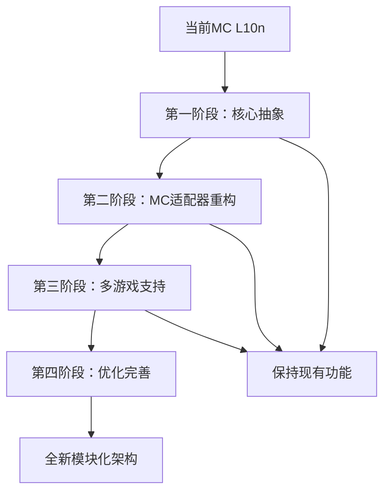

# TH-Suite 模块化架构设计方案

## 🎯 概述

本文档定义了TH-Suite从单游戏专用工具向多游戏通用平台的模块化重构方案，旨在将文件传输、进度监控、压缩等通用功能抽象为可复用组件，同时保持游戏专属逻辑的独立性。

## 🏗️ 架构原则

### 核心设计原则
1. **关注点分离**: 通用功能与游戏专属功能严格分离
2. **接口标准化**: 定义统一的游戏适配器接口规范
3. **插件化架构**: 支持游戏模块的动态加载和热插拔
4. **配置驱动**: 通过配置文件定义游戏特性和行为
5. **向前兼容**: 现有MC L10n功能无损迁移

### 质量属性要求
- **可扩展性**: 新增游戏支持时代码变更最小化
- **可维护性**: 清晰的模块边界和依赖关系
- **性能**: 通用组件高度优化，支持并发处理
- **安全性**: 统一的安全验证和权限控制
- **可测试性**: 高内聚低耦合，便于单元测试

## 📂 目录结构设计

```
TH-Suite/
├── packages/                           # 共享包管理
│   ├── core/                          # 通用核心功能
│   │   ├── file-transfer/             # 文件传输引擎
│   │   │   ├── chunked-upload/        # 分块上传
│   │   │   ├── resume-manager/        # 断点续传
│   │   │   ├── progress-tracker/      # 进度跟踪
│   │   │   └── transfer-engine/       # 传输引擎
│   │   ├── compression/               # 压缩服务
│   │   │   ├── zstd-service/          # Zstd压缩
│   │   │   ├── dictionary-manager/    # 字典管理
│   │   │   └── compression-adapter/   # 压缩适配器
│   │   ├── security/                  # 安全验证
│   │   │   ├── auth-manager/          # 认证管理
│   │   │   ├── permission-control/    # 权限控制
│   │   │   └── encryption/            # 加密服务
│   │   ├── websocket/                 # 实时通信
│   │   │   ├── connection-manager/    # 连接管理
│   │   │   ├── message-router/        # 消息路由
│   │   │   └── event-dispatcher/      # 事件分发
│   │   ├── caching/                   # 缓存管理
│   │   │   ├── multi-layer-cache/     # 多层缓存
│   │   │   ├── fingerprint-service/   # 指纹服务
│   │   │   └── cache-invalidation/    # 缓存失效
│   │   └── storage/                   # 存储管理
│   │       ├── database-abstraction/  # 数据库抽象
│   │       ├── file-system/           # 文件系统
│   │       └── backup-manager/        # 备份管理
│   ├── protocols/                     # 通用协议
│   │   ├── uida/                      # UIDA协议实现
│   │   ├── trans-hub/                 # Trans-Hub协议
│   │   └── game-adapter/              # 游戏适配器协议
│   ├── ui-components/                 # 通用UI组件
│   │   ├── progress-indicators/       # 进度指示器
│   │   ├── file-browsers/             # 文件浏览器
│   │   ├── status-displays/           # 状态显示
│   │   └── configuration-panels/      # 配置面板
│   └── shared/                        # 共享工具
│       ├── types/                     # 类型定义
│       ├── utils/                     # 工具函数
│       ├── constants/                 # 常量定义
│       └── validators/                # 验证器
├── apps/                              # 游戏专属应用
│   ├── mc_l10n/                       # Minecraft本地化
│   │   ├── adapters/                  # MC专属适配器
│   │   │   ├── mod-loader-detector/   # MOD加载器检测
│   │   │   ├── jar-processor/         # JAR文件处理
│   │   │   ├── resource-pack-handler/ # 资源包处理
│   │   │   └── lang-file-parser/      # 语言文件解析
│   │   ├── domain/                    # MC领域模型
│   │   │   ├── mod-entities/          # MOD实体
│   │   │   ├── project-entities/      # 项目实体
│   │   │   └── translation-entities/  # 翻译实体
│   │   ├── infrastructure/            # MC基础设施
│   │   │   ├── scanners/              # 扫描器
│   │   │   ├── builders/              # 构建器
│   │   │   └── validators/            # 验证器
│   │   └── ui/                        # MC专属UI
│   │       ├── project-management/    # 项目管理界面
│   │       ├── mod-browser/           # MOD浏览器
│   │       └── build-tools/           # 构建工具界面
│   ├── rw_l10n/                       # RimWorld本地化
│   │   ├── adapters/                  # RW专属适配器
│   │   │   ├── mod-detector/          # 模组检测
│   │   │   ├── xml-processor/         # XML处理
│   │   │   └── def-parser/            # Definition解析
│   │   ├── domain/                    # RW领域模型
│   │   ├── infrastructure/            # RW基础设施
│   │   └── ui/                        # RW专属UI
│   └── factorio_l10n/                 # Factorio本地化
│       ├── adapters/                  # Factorio专属适配器
│       │   ├── mod-info-parser/       # mod-info解析
│       │   ├── locale-processor/      # locale处理
│       │   └── data-processor/        # 数据处理
│       ├── domain/                    # Factorio领域模型
│       ├── infrastructure/            # Factorio基础设施
│       └── ui/                        # Factorio专属UI
├── configs/                           # 配置管理
│   ├── games/                         # 游戏配置
│   │   ├── minecraft.yml              # Minecraft配置
│   │   ├── rimworld.yml               # RimWorld配置
│   │   └── factorio.yml               # Factorio配置
│   ├── core/                          # 核心配置
│   │   ├── file-transfer.yml          # 文件传输配置
│   │   ├── compression.yml            # 压缩配置
│   │   └── security.yml               # 安全配置
│   └── deployment/                    # 部署配置
│       ├── development.yml            # 开发环境
│       ├── staging.yml                # 测试环境
│       └── production.yml             # 生产环境
├── plugins/                           # 插件系统
│   ├── game-adapters/                 # 游戏适配器插件
│   ├── compression-plugins/           # 压缩插件
│   ├── security-plugins/              # 安全插件
│   └── ui-plugins/                    # UI插件
└── tools/                             # 开发工具
    ├── plugin-generator/              # 插件生成器
    ├── config-validator/              # 配置验证器
    └── migration-tools/               # 迁移工具
```

## 🔌 接口标准化设计

### 游戏适配器接口

```typescript
// packages/protocols/game-adapter/interfaces.ts
export interface GameAdapter {
  // 基本信息
  readonly gameId: string;
  readonly name: string;
  readonly version: string;
  readonly supportedFormats: string[];
  
  // 项目检测
  detectProjects(directory: string): Promise<GameProject[]>;
  validateProject(project: GameProject): Promise<ValidationResult>;
  
  // 文件处理
  extractLanguageFiles(project: GameProject): Promise<LanguageFile[]>;
  parseLanguageFile(file: LanguageFile): Promise<TranslationEntry[]>;
  
  // 构建和导出
  buildProject(project: GameProject, options: BuildOptions): Promise<BuildResult>;
  exportTranslations(project: GameProject, format: ExportFormat): Promise<ExportResult>;
  
  // 生命周期
  initialize(config: GameConfig): Promise<void>;
  dispose(): Promise<void>;
}

export interface GameProject {
  id: string;
  name: string;
  type: ProjectType;
  path: string;
  metadata: ProjectMetadata;
  gameSpecificData: Record<string, any>;
}

export interface LanguageFile {
  id: string;
  path: string;
  format: FileFormat;
  language: string;
  content: string | Buffer;
  metadata: FileMetadata;
}

export interface TranslationEntry {
  key: string;
  sourceText: string;
  translatedText?: string;
  context?: string;
  metadata: EntryMetadata;
}
```

### 文件传输接口

```typescript
// packages/core/file-transfer/interfaces.ts
export interface FileTransferEngine {
  // 上传功能
  uploadFile(file: File, options: UploadOptions): Promise<UploadResult>;
  uploadChunked(file: File, options: ChunkedUploadOptions): Promise<UploadResult>;
  resumeUpload(uploadId: string): Promise<UploadResult>;
  
  // 下载功能
  downloadFile(url: string, options: DownloadOptions): Promise<DownloadResult>;
  downloadStream(url: string, options: StreamOptions): AsyncIterable<Uint8Array>;
  
  // 进度监控
  onProgress(callback: ProgressCallback): void;
  getProgress(transferId: string): Promise<TransferProgress>;
  
  // 控制操作
  pauseTransfer(transferId: string): Promise<void>;
  resumeTransfer(transferId: string): Promise<void>;
  cancelTransfer(transferId: string): Promise<void>;
}

export interface UploadOptions {
  chunkSize?: number;
  maxRetries?: number;
  compression?: CompressionOptions;
  encryption?: EncryptionOptions;
  metadata?: Record<string, any>;
}

export interface TransferProgress {
  transferId: string;
  status: TransferStatus;
  bytesTransferred: number;
  totalBytes: number;
  percentage: number;
  speed: number;
  estimatedTimeRemaining: number;
}
```

### 压缩服务接口

```typescript
// packages/core/compression/interfaces.ts
export interface CompressionService {
  // 压缩操作
  compress(data: Buffer, options: CompressionOptions): Promise<Buffer>;
  decompress(data: Buffer, options: DecompressionOptions): Promise<Buffer>;
  
  // 流式压缩
  createCompressionStream(options: CompressionOptions): Transform;
  createDecompressionStream(options: DecompressionOptions): Transform;
  
  // 字典管理
  createDictionary(samples: Buffer[], options: DictionaryOptions): Promise<Buffer>;
  loadDictionary(dictionary: Buffer): Promise<void>;
  
  // 统计信息
  getCompressionRatio(originalSize: number, compressedSize: number): number;
  getStatistics(): CompressionStatistics;
}

export interface CompressionOptions {
  level: CompressionLevel;
  dictionary?: Buffer;
  windowSize?: number;
  chunkSize?: number;
}

export enum CompressionLevel {
  Fast = 1,
  Balanced = 6,
  High = 15,
  Maximum = 22
}
```

## 🔧 核心服务架构

### 服务容器设计

```typescript
// packages/core/container/service-container.ts
export class ServiceContainer {
  private services = new Map<string, any>();
  private factories = new Map<string, ServiceFactory>();
  private singletons = new Map<string, any>();
  
  // 服务注册
  register<T>(key: string, factory: ServiceFactory<T>, singleton = true): void;
  registerInstance<T>(key: string, instance: T): void;
  
  // 服务解析
  resolve<T>(key: string): T;
  resolveAll<T>(key: string): T[];
  
  // 游戏适配器管理
  registerGameAdapter(adapter: GameAdapter): void;
  getGameAdapter(gameId: string): GameAdapter;
  getAllGameAdapters(): GameAdapter[];
  
  // 生命周期管理
  initialize(): Promise<void>;
  dispose(): Promise<void>;
}

// 全局服务键
export const ServiceKeys = {
  // 核心服务
  FILE_TRANSFER_ENGINE: 'fileTransferEngine',
  COMPRESSION_SERVICE: 'compressionService',
  SECURITY_MANAGER: 'securityManager',
  CACHE_SERVICE: 'cacheService',
  
  // 游戏适配器
  MINECRAFT_ADAPTER: 'minecraftAdapter',
  RIMWORLD_ADAPTER: 'rimworldAdapter',
  FACTORIO_ADAPTER: 'factorioAdapter',
  
  // UI服务
  PROGRESS_SERVICE: 'progressService',
  NOTIFICATION_SERVICE: 'notificationService'
} as const;
```

### 插件系统架构

```typescript
// packages/core/plugins/plugin-manager.ts
export class PluginManager {
  private plugins = new Map<string, Plugin>();
  private hooks = new Map<string, Hook[]>();
  
  // 插件生命周期
  loadPlugin(pluginPath: string): Promise<void>;
  unloadPlugin(pluginId: string): Promise<void>;
  reloadPlugin(pluginId: string): Promise<void>;
  
  // Hook系统
  registerHook(name: string, hook: Hook): void;
  executeHook(name: string, context: any): Promise<any>;
  
  // 插件查询
  getPlugin(pluginId: string): Plugin | undefined;
  getAllPlugins(): Plugin[];
  getPluginsByType(type: PluginType): Plugin[];
}

export interface Plugin {
  id: string;
  name: string;
  version: string;
  type: PluginType;
  dependencies: string[];
  
  // 生命周期方法
  initialize(container: ServiceContainer): Promise<void>;
  activate(): Promise<void>;
  deactivate(): Promise<void>;
  dispose(): Promise<void>;
}

export enum PluginType {
  GameAdapter = 'game-adapter',
  Compression = 'compression',
  Security = 'security',
  UI = 'ui',
  Custom = 'custom'
}
```

## 📋 配置驱动系统

### 游戏配置规范

```yaml
# configs/games/minecraft.yml
game:
  id: minecraft
  name: Minecraft
  version: "1.0.0"
  
file_formats:
  supported:
    - json
    - properties
  primary: json
  
mod_loaders:
  - forge
  - fabric
  - quilt
  - neoforge
  
project_types:
  - mod
  - resource_pack
  - data_pack
  
scanning:
  file_patterns:
    - "assets/*/lang/*.json"
    - "data/*/lang/*.json"
    - "assets/*/lang/*.properties"
  
  exclude_patterns:
    - "**/.git/**"
    - "**/node_modules/**"
    - "**/*.jar.tmp"
  
  jar_processing:
    enabled: true
    max_size: "100MB"
    backup_enabled: true
  
build:
  output_formats:
    - jar
    - zip
    - directory
  
  validation:
    syntax_check: true
    key_consistency: true
    encoding_validation: true
    
compression:
  enabled: true
  level: balanced
  dictionary_enabled: true
  dictionary_language_specific: true
```

### 核心服务配置

```yaml
# configs/core/file-transfer.yml
file_transfer:
  chunked_upload:
    default_chunk_size: "5MB"
    max_chunk_size: "50MB"
    min_chunk_size: "1MB"
    
  concurrent_uploads:
    max_parallel: 8
    adaptive_concurrency: true
    
  retry_policy:
    max_retries: 3
    backoff_strategy: "exponential"
    base_delay: "1s"
    max_delay: "30s"
    
  resume:
    enabled: true
    token_expiry: "24h"
    cleanup_interval: "1h"
    
  bandwidth:
    throttling_enabled: false
    max_upload_speed: null
    max_download_speed: null
```

## 🚀 实现计划

### 第一阶段：核心抽象 (2-3周)

#### 目标
- 提取现有MC L10n中的通用功能
- 创建核心服务接口和抽象类
- 建立基础的服务容器架构

#### 任务列表
1. **核心接口设计**
   - 定义GameAdapter、FileTransferEngine等核心接口
   - 设计服务容器和依赖注入框架
   - 建立插件系统基础架构

2. **文件传输模块抽象**
   - 从现有代码中提取chunked-upload逻辑
   - 创建通用的进度跟踪组件
   - 实现断点续传机制的抽象

3. **压缩服务模块化**
   - 抽象Zstd压缩服务
   - 创建字典管理组件
   - 设计可插拔的压缩策略

### 第二阶段：Minecraft适配器重构 (2-3周)

#### 目标
- 将现有MC L10n重构为游戏适配器模式
- 实现向前兼容性保证
- 验证架构设计的可行性

#### 任务列表
1. **MC适配器实现**
   - 实现MinecraftGameAdapter接口
   - 重构现有扫描逻辑为适配器模式
   - 迁移JAR处理和MOD加载器检测

2. **UI组件抽象**
   - 提取通用的进度指示器组件
   - 创建可复用的文件浏览器组件
   - 设计游戏特定的UI扩展点

3. **配置系统集成**
   - 实现配置驱动的游戏检测
   - 建立运行时配置热更新机制
   - 创建配置验证和错误处理

### 第三阶段：多游戏支持扩展 (3-4周)

#### 目标
- 实现RimWorld和Factorio适配器
- 验证架构的可扩展性
- 完善插件系统

#### 任务列表
1. **RimWorld适配器开发**
   - 实现RimWorld模组检测逻辑
   - 处理XML格式的翻译文件
   - 支持Def文件的本地化提取

2. **Factorio适配器开发**
   - 实现mod-info.json解析
   - 处理locale文件夹结构
   - 支持.cfg格式的本地化文件

3. **插件系统完善**
   - 实现插件的动态加载和卸载
   - 建立插件市场和分发机制
   - 创建插件开发工具和模板

### 第四阶段：优化和完善 (2-3周)

#### 目标
- 性能优化和内存管理
- 安全性增强
- 文档和测试完善

#### 任务列表
1. **性能优化**
   - 实现多层缓存策略
   - 优化大文件处理性能
   - 建立性能监控和指标收集

2. **安全性增强**
   - 实现细粒度的权限控制
   - 加强文件验证和安全扫描
   - 建立安全审计日志

3. **测试和文档**
   - 编写全面的单元测试和集成测试
   - 创建API文档和开发者指南
   - 建立持续集成和自动化测试

## 🔄 迁移策略

### 向前兼容性保证

1. **API兼容性**
   - 保持现有MC L10n API的完整性
   - 通过适配器模式包装新的接口
   - 提供遗留API的渐进式弃用路径

2. **数据兼容性**
   - 保持现有数据库schema的兼容性
   - 实现数据迁移脚本和工具
   - 支持新旧数据格式的双向转换

3. **配置兼容性**
   - 自动检测和转换旧配置格式
   - 提供配置迁移向导
   - 保持用户设置和偏好的连续性

### 渐进式迁移路径



## 📊 架构决策记录 (ADR)

### ADR-001: 采用游戏适配器模式

**状态**: 已接受  
**日期**: 2025-09-19

**背景**: 需要支持多个游戏的本地化工具，每个游戏有不同的文件格式和处理逻辑。

**决策**: 采用适配器模式统一游戏接口，通过标准化的GameAdapter接口隔离游戏特定逻辑。

**后果**:
- ✅ 优势：清晰的接口边界，易于扩展新游戏支持
- ✅ 优势：游戏特定逻辑封装，便于独立开发和维护
- ❌ 劣势：增加了抽象层，可能影响性能
- ❌ 劣势：需要重构现有代码

### ADR-002: 选择依赖注入容器架构

**状态**: 已接受  
**日期**: 2025-09-19

**背景**: 需要管理复杂的服务依赖关系，支持插件系统的动态加载。

**决策**: 实现轻量级的依赖注入容器，支持单例模式和工厂模式。

**后果**:
- ✅ 优势：松耦合的服务架构，便于测试和维护
- ✅ 优势：支持插件的动态注册和解析
- ❌ 劣势：增加了系统复杂性
- ❌ 劣势：需要额外的容器初始化逻辑

### ADR-003: 采用配置驱动的游戏检测

**状态**: 已接受  
**日期**: 2025-09-19

**背景**: 不同游戏有不同的项目结构和文件格式，需要灵活的检测机制。

**决策**: 通过YAML配置文件定义游戏特性，支持运行时配置更新。

**后果**:
- ✅ 优势：无需修改代码即可支持新的游戏变体
- ✅ 优势：用户可以自定义游戏检测规则
- ❌ 劣势：配置文件的复杂性可能导致错误
- ❌ 劣势：需要配置验证和错误处理机制

## 🎯 成功指标

### 技术指标
- **模块化程度**: 通用代码与游戏专属代码的比例达到 70:30
- **接口标准化**: 所有游戏适配器遵循统一接口，接口覆盖率100%
- **性能**: 文件传输性能相比现有实现提升20%以上
- **内存使用**: 多游戏支持时内存使用不超过单游戏的150%

### 功能指标
- **向前兼容**: 现有MC L10n功能100%兼容
- **扩展性**: 新增游戏支持时代码修改量<200行
- **插件生态**: 提供至少3个不同类型的示例插件
- **配置灵活性**: 支持90%以上的游戏变体通过配置定义

### 用户体验指标
- **迁移成本**: 现有用户迁移时无需重新配置
- **学习成本**: 新游戏适配器开发时间<2天
- **稳定性**: 系统崩溃率<0.1%
- **响应性**: UI响应时间<100ms

## 📝 总结

这个模块化架构设计将TH-Suite从单一游戏工具转变为可扩展的多游戏本地化平台。通过核心功能抽象、标准化接口设计和插件系统，我们能够：

1. **降低维护成本**: 通用功能的复用减少重复代码
2. **提高扩展性**: 新游戏支持变得简单快速
3. **保证兼容性**: 现有用户体验不受影响
4. **增强可测试性**: 清晰的模块边界便于单元测试

这个架构设计为TH-Suite的长期发展奠定了坚实基础，支持未来更多游戏和功能的集成。